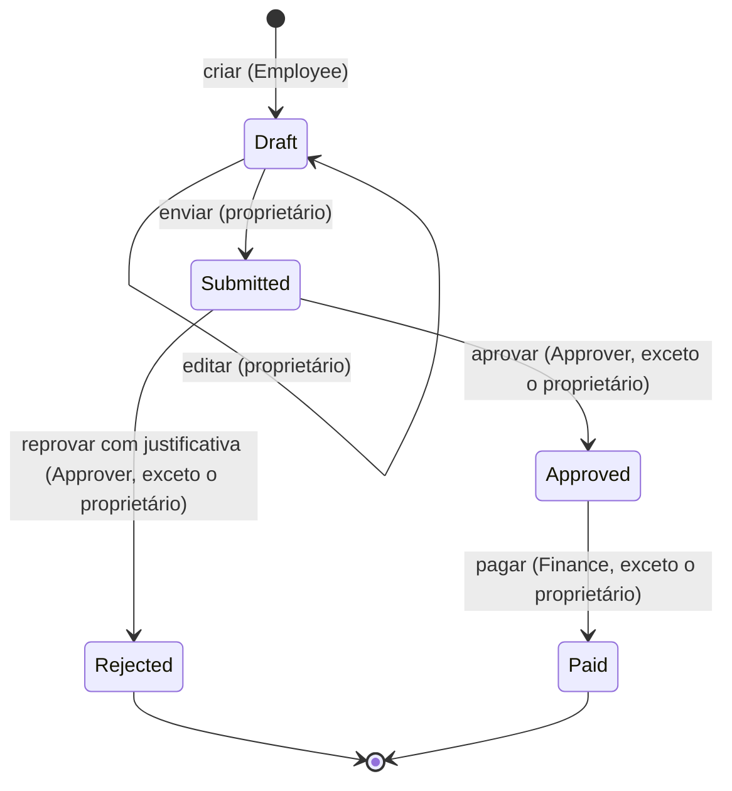

# ExpenseHub


[](https://github.com/RafaelGbm/CP2_Recass/actions/workflows/build.yml)

API REST de reembolsos corporativos, desenvolvida para o Checkpoint 2 de C# (FIAP).

Funcionários registram despesas, aprovadores analisam os pedidos, o financeiro registra pagamentos e auditores consultam o histórico. Cada operação considera a identidade autenticada, as roles, o proprietário do reembolso e o estado atual.

> Especificação completa em [`docs/`](docs/) e nas issues de [`Racass/checkpoint-csharpracass-expensehub`](https://github.com/Racass/checkpoint-csharpracass-expensehub/issues).

## Integrantes

| Nome | RM | GitHub |
|---|---|---|
| Rafael Gaspar Bragança Martins | 557228 | [@RafaelGbm](https://github.com/RafaelGbm) |
| Vinícius Monteiro Araújo | 555088 | [@Monteiro77](https://github.com/Monteiro77) |

## Sumário

- [Tecnologias](#tecnologias)
- [Como executar](#como-executar)
- [Banco de dados](#banco-de-dados)
- [Fluxo do reembolso](#fluxo-do-reembolso)
- [Autenticação e roles](#autenticação-e-roles)
- [Endpoints](#endpoints)
- [Regras de acesso](#regras-de-acesso)
- [Respostas de erro](#respostas-de-erro)
- [Testes](#testes)
- [Issues e pull requests](#issues-e-pull-requests)

## Tecnologias

| | |
|---|---|
| **API** | .NET 10 e ASP.NET Core (controllers) |
| **Autenticação** | ASP.NET Core Identity com token bearer |
| **Persistência** | Entity Framework Core 10 com SQLite |
| **Testes** | MSTest |
| **Qualidade** | StyleCop, analisadores do .NET e workflow `code-quality` |

## Como executar

**Pré-requisito:** [.NET SDK 10](https://dotnet.microsoft.com/download). Os comandos são executados na raiz do repositório.

```shell
# 1. Dependências e ferramentas locais (dotnet-ef)
dotnet restore ./sources/ExpenseHub.slnx
dotnet tool restore

# 2. Senha da conta Admin inicial (fica fora do repositório, nos User Secrets)
dotnet user-secrets set "Seed:AdminPassword" "<sua-senha>" --project ./sources/ExpenseHub.Api

# 3. Build, testes e execução
dotnet build ./sources/ExpenseHub.slnx
dotnet test ./sources/ExpenseHub.slnx
dotnet run --project ./sources/ExpenseHub.Api/ExpenseHub.Api.csproj
```

A API sobe em `http://localhost:5245` e responde `{"status":"ok"}` em `GET /health`. Na primeira execução, ela cria o banco, as roles e a conta Admin.

As requisições prontas estão em [`ExpenseHub.Api.http`](sources/ExpenseHub.Api/ExpenseHub.Api.http) (VS Code com REST Client, ou Visual Studio).

## Banco de dados

| | |
|---|---|
| **Provider** | SQLite, com `Microsoft.EntityFrameworkCore.Sqlite` 10.0.12 |
| **Connection string** | `ConnectionStrings:ExpenseHub` no `appsettings.json` (`Data Source=expensehub.db`), sem segredos. Pode ser trocada pela variável `ConnectionStrings__ExpenseHub` |
| **Criação e atualização** | Automáticas ao iniciar a API, em qualquer ambiente: as migrations pendentes são aplicadas e o seed é executado |
| **Arquivo** | `sources/ExpenseHub.Api/expensehub.db`, ignorado pelo Git. Para recomeçar do zero, pare a API e apague o arquivo |

Para aplicar as migrations manualmente ou criar uma nova:

```shell
dotnet dotnet-ef database update --project ./sources/ExpenseHub.Api
dotnet dotnet-ef migrations add NomeDaMigration --project ./sources/ExpenseHub.Api --output-dir Migrations
```

<details>
<summary><b>Entidades</b></summary>

| Entidade | Campos principais |
|---|---|
| `Expense` | `Id`, `OwnerId`, `Description`, `Amount` (`decimal`), `ExpenseDate`, `CategoryId` (opcional), `Status`, `CreatedAtUtc`, `UpdatedAtUtc` |
| `ExpenseCategory` | `Id`, `Name`. Categorias de referência: 1 Transporte, 2 Alimentação, 3 Hospedagem, 4 Outros |
| `ExpenseHistory` | `Action`, `ActorId`, `OccurredAtUtc`, `PreviousStatus`, `NewStatus`, `Justification`, `Changes` |
| `PaymentRecord` | `ExpenseId` (único), `PaidById`, `PaidAtUtc` |

- Um único valor por reembolso, sem coleção de itens.
- Estados gravados como texto; instantes gravados e devolvidos em UTC.
- O estado do reembolso é token de concorrência: duas alterações simultâneas não geram dois históricos.

</details>

## Fluxo do reembolso



- `Rejected` e `Paid` são finais. Não existem reabertura, cancelamento, exclusão ou reenvio.
- O estado nunca vem do cliente: muda apenas pelas rotas de ação.
- Repetir uma transição, ou tentá-la fora do estado esperado, responde `409` e não grava histórico.
- Toda ação grava o histórico (ator, instante UTC, estado anterior e posterior) na mesma operação da alteração. A edição registra o que mudou em `changes` (`amount: 85.50 -> 171.00`), e a reprovação guarda a justificativa.

## Autenticação e roles

| Role | Pode |
|---|---|
| `Employee` | Criar, editar, enviar e consultar os próprios reembolsos |
| `Approver` | Consultar os enviados e aprovar ou reprovar os de outras pessoas |
| `Finance` | Consultar os aprovados e pagos e pagar os de outras pessoas |
| `Auditor` | Consultar todos os reembolsos e históricos, sem alterar nada |
| `Admin` | Listar usuários e alterar roles, sem acesso aos reembolsos |

**Conta Admin inicial.** O seed cria as cinco roles e **uma única** conta Admin (`admin@expensehub.local`), e pode rodar várias vezes sem duplicar nada. A senha vem de `Seed:AdminPassword` (User Secrets ou variável `Seed__AdminPassword`) e nunca fica no código. Sem ela, a API inicia e registra um aviso, mas não cria o Admin.

**Login.** `POST /login` com e-mail e senha devolve um `accessToken` válido por 1 hora. Envie-o como `Authorization: Bearer <token>`.

**Cadastro.** `POST /register` cria o usuário **sem nenhuma role** e recusa qualquer campo além de `email` e `password`. As roles são atribuídas só pelo Admin.

> **Novo login após troca de roles.** Quando o Admin altera as roles de um usuário, os tokens emitidos antes passam a receber `401`. O usuário precisa fazer login de novo para receber um token com as roles atuais.

<details>
<summary><b>Exemplos: login, cadastro e troca de roles</b></summary>

```http
POST /login
Content-Type: application/json

{ "email": "admin@expensehub.local", "password": "<senha>" }
```

```json
{ "tokenType": "Bearer", "accessToken": "<token>", "expiresIn": 3600, "refreshToken": "<token>" }
```

```http
POST /register
Content-Type: application/json

{ "email": "ana@empresa.com", "password": "<senha>" }
```

```json
{ "id": "5686acf2-997c-4d19-ac0a-0e6d34a8b1f2", "email": "ana@empresa.com", "roles": [] }
```

```http
PUT /api/admin/users/{id}/roles
Authorization: Bearer <token do Admin>
Content-Type: application/json

{ "roles": ["Employee"] }
```

```json
{ "id": "5686acf2-997c-4d19-ac0a-0e6d34a8b1f2", "email": "ana@empresa.com", "roles": ["Employee"] }
```

- O corpo é o conjunto completo de roles: as ausentes são removidas.
- Só as cinco roles conhecidas, com o nome exato. Role desconhecida responde `400`.
- O Admin não pode remover a própria role Admin (`400`).
- A senha segue a política padrão do Identity: 6 caracteres ou mais, com maiúscula, minúscula, número e símbolo.

</details>

## Endpoints

| Método | Rota | Quem acessa | Sucesso |
|---|---|---|:---:|
| `POST` | `/register` | público | `201` |
| `POST` | `/login` | público | `200` |
| `GET` | `/api/admin/users` | Admin | `200` |
| `PUT` | `/api/admin/users/{id}/roles` | Admin | `200` |
| `POST` | `/api/expenses` | Employee | `201` |
| `PUT` | `/api/expenses/{id}` | Employee (proprietário, em `Draft`) | `200` |
| `POST` | `/api/expenses/{id}/submit` | Employee (proprietário, em `Draft`) | `200` |
| `GET` | `/api/expenses` | Employee, Approver, Finance, Auditor | `200` |
| `GET` | `/api/expenses/{id}` | Employee, Approver, Finance, Auditor | `200` |
| `POST` | `/api/expenses/{id}/approve` | Approver (não proprietário, em `Submitted`) | `200` |
| `POST` | `/api/expenses/{id}/reject` | Approver (não proprietário, em `Submitted`) | `200` |
| `POST` | `/api/expenses/{id}/pay` | Finance (não proprietário, em `Approved`) | `200` |
| `GET` | `/api/expenses/{id}/history` | Employee, Approver, Finance, Auditor | `200` |

**Validação de criação e edição:**

| Campo | Regra |
|---|---|
| `description` | Obrigatória, de 10 a 500 caracteres |
| `amount` | Obrigatório, de `0.01` a `2147483647` (`Int32.MaxValue`) |
| `expenseDate` | Obrigatória (`yyyy-MM-dd`) e não futura, considerando o dia em Brasília |
| `categoryId` | Opcional; quando informada, precisa existir |
| `justification` (reprovação) | Obrigatória, de 10 a 500 caracteres |

Campos controlados pelo servidor, como `ownerId`, `status`, `createdAtUtc` ou `actorId`, são recusados com `400`.

<details>
<summary><b>Exemplo: criar um reembolso</b></summary>

```http
POST /api/expenses
Authorization: Bearer <token de um Employee>
Content-Type: application/json

{ "description": "Táxi do aeroporto ao hotel", "amount": 85.50, "expenseDate": "2026-09-20", "categoryId": 1 }
```

```json
{
  "id": "19a93b67-8981-453e-83e3-a0c2bf070ba0",
  "ownerId": "e6e5ee2f-5c7e-4428-b0fd-ff6a7536b13f",
  "description": "Táxi do aeroporto ao hotel",
  "amount": 85.50,
  "expenseDate": "2026-09-20",
  "categoryId": 1,
  "categoryName": "Transporte",
  "status": "Draft",
  "createdAtUtc": "2026-10-11T09:59:38.3043027Z",
  "updatedAtUtc": "2026-10-11T09:59:38.3043027Z"
}
```

As rotas de ação e de consulta devolvem o reembolso no mesmo formato. A reprovação recebe `{ "justification": "..." }`; aprovar, enviar e pagar não têm corpo.

</details>

<details>
<summary><b>Exemplo: histórico</b></summary>

```json
[
  { "action": "Created",   "previousStatus": null,        "newStatus": "Draft",     "changes": null },
  { "action": "Updated",   "previousStatus": "Draft",     "newStatus": "Draft",     "changes": "amount: 85.50 -> 171.00" },
  { "action": "Submitted", "previousStatus": "Draft",     "newStatus": "Submitted", "changes": null },
  { "action": "Approved",  "previousStatus": "Submitted", "newStatus": "Approved",  "changes": null },
  { "action": "Paid",      "previousStatus": "Approved",  "newStatus": "Paid",      "changes": null }
]
```

Cada registro também traz `actorId`, `occurredAtUtc` (UTC) e `justification` (preenchida na reprovação). Os campos foram resumidos acima para facilitar a leitura.

</details>

## Regras de acesso

As roles acumulam: quem tem várias recebe a união das permissões, mas **ninguém aprova ou paga o próprio reembolso**. Criar, editar e enviar exigem a role `Employee`. As decisões de propriedade e estado ficam na camada de serviço, não apenas no `[Authorize]`.

| Perfil | Enxerga (listagem, detalhe e histórico) |
|---|---|
| Employee | Os próprios reembolsos |
| Approver | Os `Submitted` |
| Finance | Os `Approved` e `Paid` |
| Auditor | Todos |
| Admin sem outra role | Nenhum (`403`) |

O filtro é aplicado na consulta ao banco, antes de materializar os dados. Um reembolso fora do escopo responde `404`, o que isola os dados de um Employee dos demais.

**Ordem das respostas:** sem token, `401` → sem a role da rota, `403` → fora do escopo, `404` → proprietário em operação proibida, `403` → estado incompatível, `409`.

Na aprovação, na reprovação e no pagamento, os reembolsos que já saíram de `Draft` também são alcançados por quem tem a role da operação. Assim, decidir de novo um reembolso já decidido responde `409`, e não `404`.

## Respostas de erro

Todos os erros usam `ProblemDetails`.

| Status | Quando |
|:---:|---|
| `400` | Entrada inválida, campo não permitido, role desconhecida ou remoção da própria role Admin |
| `401` | Sem token, token inválido, expirado ou anterior a uma troca de roles; credenciais erradas no login |
| `403` | Sem a role exigida ou violando a regra de propriedade |
| `404` | Recurso inexistente ou fora do escopo de leitura |
| `409` | Transição de estado incompatível ou repetida |

<details>
<summary><b>Exemplo de erro</b></summary>

```json
{
  "type": "https://tools.ietf.org/html/rfc9110#section-15.5.10",
  "title": "O estado atual do reembolso não permite esta operação.",
  "status": 409,
  "traceId": "00-..."
}
```

</details>

## Testes

```shell
dotnet test ./sources/ExpenseHub.slnx   # 147 testes unitários
bash scripts/e2e.sh                     # 75 verificações de ponta a ponta
```

**Testes unitários.** Ficam em `sources/ExpenseHub.UnitTests` e rodam sem banco, rede ou serviço externo. Eles testam as regras do domínio: transições de estado, combinação de role, propriedade e estado, visibilidade por perfil, decisões, pagamento, histórico, validação dos dados de entrada e troca de roles.

**Roteiro de ponta a ponta.** O `scripts/e2e.sh` sobe a API com banco e senhas temporários, percorre os casos negativos obrigatórios da matriz de autorização e o fluxo completo, e desliga a API no fim. Requer bash e curl (no Windows, o Git Bash). É uma evidência complementar e não substitui os testes unitários.

## Issues e pull requests

Cada issue foi implementada em uma branch própria e integrada por pull request, com o score do workflow `code-quality` registrado (100/100 em todos).

| Issue | PR | Responsável |
|---|:---:|---|
| I01 — Fundação da solução e Entity Framework Core | [#1](https://github.com/RafaelGbm/CP2_Recass/pull/1) | Rafael |
| I02 — Identity, Admin e autenticação | [#2](https://github.com/RafaelGbm/CP2_Recass/pull/2) | Rafael |
| I03 — Cadastro HTTP e gerenciamento de roles | [#3](https://github.com/RafaelGbm/CP2_Recass/pull/3) | Rafael |
| Ajustes de conformidade das issues I01 a I03 | [#4](https://github.com/RafaelGbm/CP2_Recass/pull/4) | Rafael |
| I04 — Criar e editar rascunho | [#5](https://github.com/RafaelGbm/CP2_Recass/pull/5) | Vinícius |
| I05 — Enviar, listar e consultar | [#6](https://github.com/RafaelGbm/CP2_Recass/pull/6) | Vinícius |
| I06 — Ownership e matriz de acesso | [#7](https://github.com/RafaelGbm/CP2_Recass/pull/7) | Vinícius |
| I07 — Aprovar e reprovar com justificativa | [#9](https://github.com/RafaelGbm/CP2_Recass/pull/9) | Rafael |
| I08 — Pagamento e histórico | [#8](https://github.com/RafaelGbm/CP2_Recass/pull/8) | Vinícius |
| I09 — Testes unitários | em cada PR | Ambos |
| I10 — Qualidade de código | em cada PR | Ambos |

As decisões tomadas onde o contrato não era explícito estão registradas na descrição de cada pull request.

<details>
<summary><b>Documentação do checkpoint</b></summary>

- [Enunciado](docs/ENUNCIADO.md)
- [Requisitos e contratos](docs/REQUISITOS.md)
- [Rubrica](docs/RUBRICA.md)
- [Matriz de autorização](docs/MATRIZ-AUTORIZACAO.md)
- [Processo no GitHub](docs/PROCESSO-GITHUB.md)
- [Uso de Inteligência Artificial](docs/USO-DE-IA.md)
- [Regras do pipeline de qualidade](docs/code-quality-rules.md)

</details>
