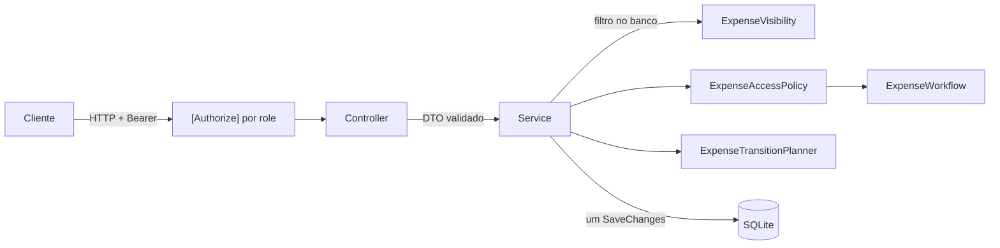

# ExpenseHub

API REST de reembolsos corporativos, desenvolvida para o Checkpoint 2 de C# (FIAP). Funcionários registram despesas, aprovadores analisam os pedidos, o financeiro registra pagamentos e auditores consultam o histórico.

Cada operação é protegida considerando, ao mesmo tempo, a identidade autenticada, as roles do usuário, o proprietário do reembolso, o estado atual e a regra de transição.

A especificação completa está em [`docs/`](docs/) e nas issues do repositório original [`Racass/checkpoint-csharpracass-expensehub`](https://github.com/Racass/checkpoint-csharpracass-expensehub/issues).

## Sumário

1. [Integrantes](#integrantes)
2. [Issues implementadas](#issues-implementadas)
3. [Tecnologias](#tecnologias)
4. [Como executar](#como-executar)
5. [Configuração](#configuração)
6. [Banco de dados](#banco-de-dados)
7. [Arquitetura](#arquitetura)
8. [Fluxo do reembolso](#fluxo-do-reembolso)
9. [Matriz de autorização](#matriz-de-autorização)
10. [Autenticação e conta Admin](#autenticação-e-conta-admin)
11. [Cadastro e gerenciamento de roles](#cadastro-e-gerenciamento-de-roles)
12. [Reembolsos](#reembolsos)
13. [Histórico](#histórico)
14. [Respostas de erro](#respostas-de-erro)
15. [Passo a passo completo](#passo-a-passo-completo)
16. [Decisões de projeto](#decisões-de-projeto)
17. [Testes](#testes)
18. [Qualidade de código](#qualidade-de-código)
19. [Solução de problemas](#solução-de-problemas)
20. [Processo de desenvolvimento](#processo-de-desenvolvimento)
21. [Documentação do checkpoint](#documentação-do-checkpoint)

## Integrantes

| Nome | RM | GitHub |
|---|---|---|
| Rafael Gaspar Bragança Martins | 557228 | [@RafaelGbm](https://github.com/RafaelGbm) |
| Vinícius Monteiro Araújo | 555088 | [@Monteiro77](https://github.com/Monteiro77) |

## Issues implementadas

| Issue | Pull request | Responsável |
|---|---|---|
| I01 — Fundação da solução e Entity Framework Core | [#1](https://github.com/RafaelGbm/CP2_Recass/pull/1) | Rafael |
| I02 — Identity, Admin e autenticação | [#2](https://github.com/RafaelGbm/CP2_Recass/pull/2) | Rafael |
| I03 — Cadastro HTTP e gerenciamento de roles | [#3](https://github.com/RafaelGbm/CP2_Recass/pull/3) | Rafael |
| Ajustes de conformidade das issues I01 a I03 | [#4](https://github.com/RafaelGbm/CP2_Recass/pull/4) | Rafael |
| I04 — Criar e editar rascunho | [#5](https://github.com/RafaelGbm/CP2_Recass/pull/5) | Vinícius |
| I05 — Enviar, listar e consultar | [#6](https://github.com/RafaelGbm/CP2_Recass/pull/6) | Vinícius |
| I06 — Ownership e matriz de acesso | [#7](https://github.com/RafaelGbm/CP2_Recass/pull/7) | Vinícius |
| I07 — Aprovar e reprovar com justificativa | [#9](https://github.com/RafaelGbm/CP2_Recass/pull/9) | Rafael |
| I08 — Pagamento e histórico | [#8](https://github.com/RafaelGbm/CP2_Recass/pull/8) | Vinícius |
| I09 — Testes unitários | Em cada PR acima | Ambos |
| I10 — Qualidade de código | Workflow `code-quality` em cada PR | Ambos |
| Roteiro de ponta a ponta (evidência) | [#10](https://github.com/RafaelGbm/CP2_Recass/pull/10) | Rafael |
| Entrega | [#11](https://github.com/RafaelGbm/CP2_Recass/pull/11) | Rafael |

Cada pull request traz o resumo técnico, as decisões, como validar, as evidências, o impacto em segurança e o score do pipeline.

## Tecnologias

| Tecnologia | Uso |
|---|---|
| .NET 10 e ASP.NET Core | API REST com controllers e `ProblemDetails` |
| ASP.NET Core Identity | Usuários, senhas com hash, roles e token bearer |
| Entity Framework Core 10 | Mapeamento, migrations e consultas |
| SQLite | Banco relacional, sem necessidade de servidor |
| MSTest | Testes unitários |
| StyleCop e analisadores do .NET | Padrão de código verificado no build e no pipeline |

## Como executar

**Pré-requisito:** [.NET SDK 10](https://dotnet.microsoft.com/download). No Windows, também é possível instalar com `winget install Microsoft.DotNet.SDK.10`.

Todos os comandos abaixo são executados a partir da raiz do repositório.

1. **Restaure as dependências e as ferramentas locais** (a ferramenta `dotnet-ef` fica declarada em `dotnet-tools.json`):

   ```shell
   dotnet restore ./sources/ExpenseHub.slnx
   dotnet tool restore
   ```

2. **Configure a senha da conta Admin inicial.** Ela fica fora do repositório, nos User Secrets da sua máquina (veja [Conta Admin inicial](#conta-admin-inicial)):

   ```shell
   dotnet user-secrets set "Seed:AdminPassword" "<sua-senha>" --project ./sources/ExpenseHub.Api
   ```

   No Git Bash, se a senha tiver `!`, use aspas simples: `'Senha@123!'`.

3. **Compile e rode os testes:**

   ```shell
   dotnet build ./sources/ExpenseHub.slnx
   dotnet test ./sources/ExpenseHub.slnx
   ```

4. **Inicie a API:**

   ```shell
   dotnet run --project ./sources/ExpenseHub.Api/ExpenseHub.Api.csproj
   ```

   A API sobe em `http://localhost:5245` (perfil `http` de `Properties/launchSettings.json`, em ambiente `Development`). Na primeira execução, ela cria o banco, aplica as migrations, cria as roles e a conta Admin.

5. **Confirme que está no ar:**

   ```shell
   curl http://localhost:5245/health
   ```

   Resposta: `{"status":"ok"}`.

Para testar as rotas, use o arquivo [`ExpenseHub.Api.http`](sources/ExpenseHub.Api/ExpenseHub.Api.http), que traz as requisições prontas para o VS Code (extensão REST Client) ou o Visual Studio, ou siga o [Passo a passo completo](#passo-a-passo-completo). Em `Development`, a descrição OpenAPI das rotas fica em `http://localhost:5245/openapi/v1.json`.

## Configuração

| Chave | Onde configurar | Valor padrão | Uso |
|---|---|---|---|
| `ConnectionStrings:ExpenseHub` | `appsettings.json` ou variável `ConnectionStrings__ExpenseHub` | `Data Source=expensehub.db` | Arquivo do banco SQLite |
| `Seed:AdminEmail` | `appsettings.json` ou variável `Seed__AdminEmail` | `admin@expensehub.local` | E-mail da conta Admin inicial |
| `Seed:AdminPassword` | User Secrets ou variável `Seed__AdminPassword` | nenhum | Senha da conta Admin inicial. **Nunca vai para o repositório** |
| `ASPNETCORE_URLS` | variável de ambiente | `http://localhost:5245` (pelo perfil `http`) | Endereço da API |
| `ASPNETCORE_ENVIRONMENT` | variável de ambiente | `Development` (pelo perfil `http`) | A descrição OpenAPI só é publicada em `Development` |
| `E2E_PORT` | variável de ambiente | `5299` | Porta usada pelo [roteiro de ponta a ponta](#roteiro-de-ponta-a-ponta) |

O `appsettings.json` não contém senhas, tokens ou connection strings sensíveis.

## Banco de dados

- **Provider e pacote:** SQLite, com `Microsoft.EntityFrameworkCore.Sqlite` (10.0.12). O pacote `Microsoft.EntityFrameworkCore.Design` é usado apenas pelas migrations, e `Microsoft.AspNetCore.Identity.EntityFrameworkCore` guarda as tabelas do Identity no mesmo banco.
- **Configuração:** a connection string fica em `ConnectionStrings:ExpenseHub`. O arquivo do banco é criado na pasta de execução da API (com `dotnet run --project`, em `sources/ExpenseHub.Api/expensehub.db`).
- **Criação e atualização:** ao iniciar, em qualquer ambiente, a API aplica as migrations pendentes e executa o seed. Para aplicar as migrations manualmente:

  ```shell
  dotnet dotnet-ef database update --project ./sources/ExpenseHub.Api
  ```

- **Nova migration** depois de alterar as entidades:

  ```shell
  dotnet dotnet-ef migrations add NomeDaMigration --project ./sources/ExpenseHub.Api --output-dir Migrations
  ```

- **Recomeçar do zero:** pare a API e apague `sources/ExpenseHub.Api/expensehub.db` (e os arquivos `-shm` e `-wal`, se existirem). Na próxima execução, tudo é recriado.

Os arquivos `*.db`, `*.db-shm` e `*.db-wal` estão no `.gitignore`. O build e os testes unitários não dependem do banco.

### Migrations

| Migration | Conteúdo |
|---|---|
| `InitialCreate` | Tabelas de reembolso, categoria, histórico e pagamento, e as quatro categorias de referência |
| `AddIdentity` | Tabelas do Identity e chaves estrangeiras de proprietário, ator e responsável pelo pagamento |
| `AlignModelWithRequirements` | Categoria opcional e campo `Changes` no histórico |
| `UseExpenseStatusAsConcurrencyToken` | Estado do reembolso como token de concorrência |

### Entidades

| Entidade | Campos | Observações |
|---|---|---|
| `Expense` | `Id` (Guid), `OwnerId`, `Description` (até 500), `Amount` (`decimal`), `ExpenseDate` (data), `CategoryId` (opcional), `Status`, `CreatedAtUtc`, `UpdatedAtUtc` | Um único valor por reembolso, sem coleção de itens. `Status` é token de concorrência |
| `ExpenseCategory` | `Id`, `Name` (único, até 100) | A migration inicial cria: 1 Transporte, 2 Alimentação, 3 Hospedagem, 4 Outros |
| `ExpenseHistory` | `Id`, `ExpenseId`, `Action`, `ActorId`, `OccurredAtUtc`, `PreviousStatus`, `NewStatus`, `Justification` (até 500), `Changes` (até 2000) | Um registro por ação; `PreviousStatus` é nulo na criação |
| `PaymentRecord` | `Id`, `ExpenseId` (único), `PaidById`, `PaidAtUtc` | No máximo um pagamento por reembolso |

- Os estados (`ExpenseStatus`) são gravados como texto: `Draft`, `Submitted`, `Approved`, `Rejected` e `Paid`.
- Todos os instantes são gravados e devolvidos em UTC (terminam em `Z` no JSON). O conversor `UtcDateTimeConverter` garante isso, porque o SQLite guarda datas como texto.
- Proprietário, ator do histórico e responsável pelo pagamento são chaves estrangeiras para o usuário do Identity.

## Arquitetura

```text
sources/
├── ExpenseHub.slnx
├── ExpenseHub.Api/
│   ├── Auth/          roles, seed do Admin, regras de troca de roles e validação do token após troca de roles
│   ├── Controllers/   endpoints HTTP: recebem DTOs, leem o usuário do token e traduzem o resultado em status HTTP
│   ├── Data/          DbContext, fábrica para as migrations e conversor de UTC
│   ├── Domain/        entidades, estados e regras puras (sem banco) de acesso, transição, visibilidade e histórico
│   ├── Dtos/          contratos de entrada e saída, com validação declarativa
│   ├── Migrations/    migrations do Entity Framework Core
│   ├── Services/      regras de negócio que combinam domínio e banco
│   └── Validation/    atributo de validação próprio (data não futura)
└── ExpenseHub.UnitTests/
    ├── Auth/          regras de troca de roles
    ├── Data/          conversor de UTC
    ├── Domain/        acesso, transições, visibilidade, decisões, histórico e datas
    └── Validation/    validação dos DTOs de entrada
scripts/
├── e2e.sh                 roteiro de ponta a ponta (evidência)
└── Invoke-CodeQuality.ps1 script do pipeline de qualidade (do template)
```

Uma requisição percorre as camadas nesta ordem:



| Classe | Responsabilidade |
|---|---|
| `ExpensesController`, `AdminUsersController`, `AuthController` | Recebem só DTOs, leem o usuário do token e convertem o resultado do serviço em status HTTP |
| `ExpenseService` | Busca o reembolso já filtrado no banco, aplica as regras e salva estado e histórico em uma única operação |
| `UserAdministrationService` | Lista usuários e aplica a troca de roles dentro de uma transação |
| `ExpenseVisibility` | Monta, como expressão traduzível para SQL, o escopo de leitura de cada role e o escopo das decisões e do pagamento |
| `ExpenseAccessPolicy` | Decide, na ordem role → propriedade → estado, se a operação é permitida (403 ou 409) |
| `ExpenseWorkflow` | Máquina de estados: única fonte das transições permitidas e dos nomes das ações do histórico |
| `ExpenseTransitionPlanner` | Monta o novo estado, o registro de histórico e, no pagamento, o `PaymentRecord` |
| `ExpenseChangeDescriber` | Descreve as alterações feitas em uma edição, para `ExpenseHistory.Changes` |
| `ExpenseDateRules` e `NotFutureDateAttribute` | Regra de data não futura |
| `RoleChangePlanner` | Calcula a troca de roles e recusa role desconhecida e remoção da própria role Admin |
| `IdentitySeeder` | Cria as roles e a única conta Admin, de forma idempotente |
| `SecurityStampValidationExtensions` | Recusa com 401 tokens emitidos antes de uma troca de roles |

As regras de domínio são classes estáticas sem acesso ao banco, por isso podem ser testadas isoladamente. As decisões de propriedade e estado ficam na camada de serviço, e não apenas no atributo `[Authorize]` do controller.

## Fluxo do reembolso


| Estado atual | Ação | Quem pode | Próximo estado |
|---|---|---|---|
| inexistente | criar | Employee | `Draft` |
| `Draft` | editar | proprietário | `Draft` |
| `Draft` | enviar | proprietário | `Submitted` |
| `Submitted` | aprovar | Approver, exceto o proprietário | `Approved` |
| `Submitted` | reprovar | Approver, exceto o proprietário | `Rejected` |
| `Approved` | pagar | Finance, exceto o proprietário | `Paid` |

- `Rejected` e `Paid` são finais.
- Não existem reabertura, cancelamento, exclusão ou reenvio.
- Repetir uma transição, ou tentar uma transição fora do estado esperado, responde `409` e não cria histórico.
- O estado nunca é informado pelo cliente: só muda pelas rotas de ação (`submit`, `approve`, `reject` e `pay`).

## Matriz de autorização

Roles acumulam permissões: um usuário com várias roles recebe a união delas, sem perder as proibições de autoaprovação e autopagamento. Criar, editar e enviar exigem a role `Employee`, mesmo para quem tem outras roles.

| Operação | Employee | Approver | Finance | Auditor | Admin | Regra contextual |
|---|:---:|:---:|:---:|:---:|:---:|---|
| Registrar usuário | público | público | público | público | público | Cadastro nunca aceita role |
| Login | público | público | público | público | público | Credenciais válidas |
| Listar usuários | não | não | não | não | sim | Somente Admin |
| Alterar roles | não | não | não | não | sim | Roles conhecidas; não remover a própria role Admin |
| Criar reembolso | sim | não | não | não | não | Proprietário vem do token |
| Editar reembolso | sim | não | não | não | não | Proprietário e estado `Draft` |
| Enviar reembolso | sim | não | não | não | não | Proprietário e estado `Draft` |
| Listar reembolsos | próprios | `Submitted` | `Approved` e `Paid` | todos | não | Filtro aplicado no banco, antes de materializar os dados |
| Consultar detalhe | próprio | `Submitted` | `Approved` e `Paid` | todos | não | Fora do escopo responde `404` |
| Aprovar | não | sim | não | não | não | `Submitted` e não proprietário |
| Reprovar | não | sim | não | não | não | `Submitted`, não proprietário e justificativa válida |
| Pagar | não | não | sim | não | não | `Approved` e não proprietário |
| Consultar histórico | próprio | visível | visível | todos | não | Mesma visibilidade do reembolso |

Ordem das respostas nas rotas de reembolso:

1. Sem token, ou token inválido → `401`.
2. Sem a role exigida pela rota → `403`.
3. Reembolso inexistente ou fora do escopo de leitura → `404`.
4. Regra de propriedade violada (por exemplo, aprovar o próprio reembolso) → `403`.
5. Estado incompatível com a operação → `409`.

Na aprovação, na reprovação e no pagamento, todo reembolso que já saiu de `Draft` é alcançado por quem tem a role da operação, mesmo fora do escopo de leitura. Assim, decidir de novo um reembolso já decidido, ou pagar um reembolso que não está em `Approved`, responde `409`, e não `404`. Rascunhos de outras pessoas continuam respondendo `404`.

## Autenticação e conta Admin

### Roles

`Admin`, `Employee`, `Approver`, `Finance` e `Auditor`. O seed cria as que faltarem ao iniciar a aplicação, e nenhuma outra role é criada.

### Conta Admin inicial

O seed cria **uma única** conta Admin, vinculada à role `Admin`, e nenhum outro usuário. Ele pode ser executado várias vezes sem duplicar roles nem usuários: se já existir um usuário com a role Admin, nada é criado.

- O e-mail vem de `Seed:AdminEmail` (`admin@expensehub.local`).
- A senha **não fica no repositório**. Configure com User Secrets (passo 2 de [Como executar](#como-executar)) ou com a variável de ambiente `Seed__AdminPassword`.
- A senha segue a política padrão do Identity: pelo menos 6 caracteres, com letra maiúscula, letra minúscula, número e símbolo.
- Sem senha configurada, a API inicia, registra no log o aviso `Conta Admin não criada: configure Seed:AdminEmail e Seed:AdminPassword` e não cria o Admin.
- A conta Admin só é criada uma vez. Trocar o secret depois não altera a senha já gravada; para recriar, apague o banco e inicie a API de novo.
- As senhas de todos os usuários são guardadas como hash pelo Identity, nunca em texto puro.

### Login

```http
POST /login
Content-Type: application/json

{ "email": "admin@expensehub.local", "password": "<sua-senha>" }
```

Resposta `200`:

```json
{ "tokenType": "Bearer", "accessToken": "<token>", "expiresIn": 3600, "refreshToken": "<token>" }
```

- Envie o `accessToken` nas rotas protegidas, no cabeçalho `Authorization: Bearer <accessToken>`.
- O token vale 1 hora (`expiresIn` em segundos). Depois disso, faça login de novo. A API não expõe rota de renovação, então o `refreshToken`, que faz parte da resposta padrão do token bearer do Identity, não é usado.
- E-mail ou senha errados respondem `401` com `"title": "Credenciais inválidas."` e nenhum token.
- E-mail mal formatado ou senha ausente respondem `400`.

## Cadastro e gerenciamento de roles

### Cadastro

```http
POST /register
Content-Type: application/json

{ "email": "ana@empresa.com", "password": "<senha>" }
```

Resposta `201`:

```json
{ "id": "5686acf2-997c-4d19-ac0a-0e6d34a8b1f2", "email": "ana@empresa.com", "roles": [] }
```

- O usuário é criado **sem nenhuma role**.
- O cadastro **não aceita roles**: qualquer campo além de `email` e `password` (por exemplo `"roles"`) é recusado com `400`.
- E-mail inválido, e-mail já cadastrado ou senha fora da política do Identity também respondem `400`, com o motivo em `errors`.
- Enquanto não receber roles do Admin, o usuário consegue fazer login, mas recebe `403` nas operações protegidas.

### Rotas do Admin

Exigem token de um usuário com a role `Admin`: sem token, `401`; com token sem Admin, `403`.

| Método | Rota | Descrição |
|---|---|---|
| GET | `/api/admin/users` | Lista usuários com suas roles, ordenados por e-mail |
| PUT | `/api/admin/users/{id}/roles` | Substitui as roles do usuário pelo conjunto enviado |

Resposta de `GET /api/admin/users`:

```json
[
  { "id": "e2938b28-19b5-44c2-bf52-2ac87b358dd4", "email": "admin@expensehub.local", "roles": ["Admin"] },
  { "id": "5686acf2-997c-4d19-ac0a-0e6d34a8b1f2", "email": "ana@empresa.com", "roles": [] }
]
```

Troca de roles:

```http
PUT /api/admin/users/{id}/roles
Authorization: Bearer <token do Admin>
Content-Type: application/json

{ "roles": ["Employee"] }
```

Resposta `200`:

```json
{ "id": "5686acf2-997c-4d19-ac0a-0e6d34a8b1f2", "email": "ana@empresa.com", "roles": ["Employee"] }
```

- O corpo é o **conjunto completo** desejado: roles ausentes são removidas, e uma lista vazia remove todas.
- Só as cinco roles conhecidas são aceitas, escritas exatamente como em [Roles](#roles). Uma role desconhecida responde `400` e nada é alterado; nenhuma role nova é criada.
- O Admin não pode remover a própria role Admin: a requisição responde `400` e nada é alterado. Ele pode dar ou tirar a role Admin de **outros** usuários.
- Usuário inexistente responde `404`.
- A remoção e a adição de roles são aplicadas em uma transação.

> **Novo login obrigatório:** depois de uma alteração de roles, os tokens emitidos antes dela passam a receber `401` com `"title": "Credencial desatualizada. Faça login novamente."`. O usuário precisa fazer login de novo para receber um token com as roles atuais.

## Reembolsos

Exigem token: sem token, `401`; com token sem a role exigida pela rota, `403`. Proprietário, estado, ator e horários são sempre definidos pelo servidor.

| Método | Rota | Role | Sucesso | Descrição |
|---|---|---|---|---|
| POST | `/api/expenses` | Employee | `201` | Cria um rascunho (`Draft`) do usuário autenticado |
| PUT | `/api/expenses/{id}` | Employee | `200` | Edita o próprio rascunho |
| POST | `/api/expenses/{id}/submit` | Employee | `200` | Envia o próprio rascunho (`Draft` → `Submitted`) |
| GET | `/api/expenses` | Employee, Approver, Finance, Auditor | `200` | Lista os reembolsos visíveis, do mais recente para o mais antigo |
| GET | `/api/expenses/{id}` | Employee, Approver, Finance, Auditor | `200` | Consulta um reembolso visível |
| POST | `/api/expenses/{id}/approve` | Approver | `200` | Aprova um reembolso enviado por outra pessoa (`Submitted` → `Approved`) |
| POST | `/api/expenses/{id}/reject` | Approver | `200` | Reprova um reembolso enviado por outra pessoa (`Submitted` → `Rejected`), com justificativa |
| POST | `/api/expenses/{id}/pay` | Finance | `200` | Registra o pagamento de um reembolso aprovado de outra pessoa (`Approved` → `Paid`) |
| GET | `/api/expenses/{id}/history` | Employee, Approver, Finance, Auditor | `200` | Histórico do reembolso, em ordem cronológica, com a mesma visibilidade do reembolso |

Todas as rotas de ação e de consulta de um reembolso devolvem o mesmo formato, mostrado abaixo.

### Criar e editar

```http
POST /api/expenses
Authorization: Bearer <token de um Employee>
Content-Type: application/json

{ "description": "Táxi do aeroporto ao hotel", "amount": 85.50, "expenseDate": "2026-09-20", "categoryId": 1 }
```

Resposta `201`:

```json
{
  "id": "19a93b67-8981-453e-83e3-a0c2bf070ba0",
  "ownerId": "e6e5ee2f-5c7e-4428-b0fd-ff6a7536b13f",
  "description": "Táxi do aeroporto ao hotel",
  "amount": 85.50,
  "expenseDate": "2026-09-20",
  "categoryId": 1,
  "categoryName": "Transporte",
  "status": "Draft",
  "createdAtUtc": "2026-10-11T09:59:38.3043027Z",
  "updatedAtUtc": "2026-10-11T09:59:38.3043027Z"
}
```

Campos aceitos na criação e na edição:

| Campo | Obrigatório | Regra |
|---|---|---|
| `description` | sim | Entre 10 e 500 caracteres; só espaços conta como ausente |
| `amount` | sim | Entre `0.01` e `2147483647` (`Int32.MaxValue`), tipo `decimal` |
| `expenseDate` | sim | Formato `yyyy-MM-dd`, válida e não futura em relação ao dia corrente em Brasília (`America/Sao_Paulo`) |
| `categoryId` | não | Quando informado, precisa existir (1 Transporte, 2 Alimentação, 3 Hospedagem, 4 Outros) |

- Qualquer outro campo, como `ownerId`, `status` ou `createdAtUtc`, é recusado com `400`.
- O `PUT` envia o rascunho completo, com os mesmos campos da criação. Só o proprietário edita, e só em `Draft`. Reembolso fora do escopo responde `404`; visível mas de outra pessoa, `403`; fora de `Draft`, `409`.
- Se a edição não mudar nada, a API responde `200` sem gravar histórico nem alterar `updatedAtUtc`.

### Enviar

`POST /api/expenses/{id}/submit`, sem corpo. Só o proprietário envia, e só em `Draft`. Fora do escopo, `404`; visível mas de outra pessoa, `403`; fora de `Draft` ou já enviado, `409`.

O estado é usado como token de concorrência: se duas operações alterarem o mesmo reembolso ao mesmo tempo, a segunda responde `409` e não grava histórico.

### Listar e consultar

- `GET /api/expenses` devolve uma lista no formato acima, do mais recente para o mais antigo.
- `GET /api/expenses/{id}` devolve um reembolso, ou `404` se ele não existir ou estiver fora do escopo de leitura.
- Escopo de leitura: Employee vê os próprios; Approver, os `Submitted`; Finance, os `Approved` e `Paid`; Auditor, todos. As roles acumulam, e o resultado é a união dos escopos. Admin sem outra role recebe `403`.
- O filtro é aplicado na consulta ao banco (`ExpenseVisibility`), e não em memória.

### Aprovar e reprovar

- `POST /api/expenses/{id}/approve`, sem corpo.
- `POST /api/expenses/{id}/reject`, com corpo:

  ```json
  { "justification": "Nota fiscal ilegível; envie uma nova cópia." }
  ```

- Só um Approver que não é o proprietário decide, e só em `Submitted`. O proprietário, mesmo tendo a role Approver, recebe `403`.
- A justificativa é obrigatória, com 10 a 500 caracteres. Justificativa ausente, curta, longa, só com espaços ou corpo com campos extras respondem `400`.
- Um reembolso recebe uma única decisão. Aprovar ou reprovar de novo, ou decidir um reembolso `Approved`, `Rejected` ou `Paid`, responde `409` sem gravar histórico.
- A justificativa é gravada no histórico, em `justification`.

### Pagar

- `POST /api/expenses/{id}/pay`, sem corpo.
- Só um Finance que não é o proprietário paga, e só em `Approved`.
- O pagamento é simulado: grava um `PaymentRecord` com o ator e o instante definidos pelo servidor, no máximo um por reembolso.
- Pagar um reembolso fora de `Approved` (`Submitted`, `Rejected` ou já `Paid`) responde `409`.
- Estado, histórico `Paid` e `PaymentRecord` são salvos em um único `SaveChangesAsync`: se a gravação falhar, nada muda.

## Histórico

`GET /api/expenses/{id}/history` devolve os registros em ordem cronológica. Quem não enxerga o reembolso recebe `404`.

| Ação | Quando | Estado anterior → posterior | Campos extras |
|---|---|---|---|
| `Created` | Criação | (nulo) → `Draft` | — |
| `Updated` | Edição com alguma mudança | `Draft` → `Draft` | `changes` |
| `Submitted` | Envio | `Draft` → `Submitted` | — |
| `Approved` | Aprovação | `Submitted` → `Approved` | — |
| `Rejected` | Reprovação | `Submitted` → `Rejected` | `justification` |
| `Paid` | Pagamento | `Approved` → `Paid` | — |

Exemplo de um reembolso criado, editado, enviado, aprovado e pago:

```json
[
  { "action": "Created", "actorId": "e6e5ee2f-...", "occurredAtUtc": "2026-10-11T09:59:38.3043027Z", "previousStatus": null, "newStatus": "Draft", "justification": null, "changes": null },
  { "action": "Updated", "actorId": "e6e5ee2f-...", "occurredAtUtc": "2026-10-11T09:59:39.118645Z", "previousStatus": "Draft", "newStatus": "Draft", "justification": null, "changes": "description: \"Táxi do aeroporto ao hotel\" -> \"Táxi do aeroporto ao hotel (ida e volta)\"; amount: 85.50 -> 171.00" },
  { "action": "Submitted", "actorId": "e6e5ee2f-...", "occurredAtUtc": "2026-10-11T09:59:39.3838596Z", "previousStatus": "Draft", "newStatus": "Submitted", "justification": null, "changes": null },
  { "action": "Approved", "actorId": "795c65cf-...", "occurredAtUtc": "2026-10-11T09:59:40.3267324Z", "previousStatus": "Submitted", "newStatus": "Approved", "justification": null, "changes": null },
  { "action": "Paid", "actorId": "58898dd7-...", "occurredAtUtc": "2026-10-11T09:59:40.569522Z", "previousStatus": "Approved", "newStatus": "Paid", "justification": null, "changes": null }
]
```

- `actorId` é o usuário autenticado que executou a ação, e `occurredAtUtc` é o instante do servidor.
- `changes` usa o formato `campo: antes -> depois`, separado por `; `, com os nomes de campo do JSON e valores em cultura invariante (por exemplo, `amount: 85.50 -> 171.00; categoryId: 1 -> null`).
- A alteração do reembolso e o registro de histórico correspondente são salvos na mesma operação.

## Respostas de erro

Todos os erros usam `ProblemDetails`:

| Status | Quando |
|---|---|
| `400` | Entrada inválida: campo fora das regras, campo não permitido, corpo ausente, role desconhecida, remoção da própria role Admin, categoria inexistente |
| `401` | Sem token, token inválido ou expirado, token emitido antes de uma troca de roles, credenciais erradas no login |
| `403` | Autenticado, mas sem a role exigida, ou violando a regra de propriedade |
| `404` | Recurso inexistente ou fora do escopo de leitura |
| `409` | Transição de estado incompatível ou repetida |

Exemplo de `400` de validação:

```json
{
  "type": "https://tools.ietf.org/html/rfc9110#section-15.5.1",
  "title": "One or more validation errors occurred.",
  "status": 400,
  "errors": {
    "Amount": ["The field Amount must be between 0,01 and 2147483647."],
    "Description": ["The field Description must be a string with a minimum length of 10 and a maximum length of 500."],
    "ExpenseDate": ["O campo ExpenseDate não pode ser uma data futura."]
  },
  "traceId": "00-..."
}
```

Exemplo de `409`:

```json
{
  "type": "https://tools.ietf.org/html/rfc9110#section-15.5.10",
  "title": "O estado atual do reembolso não permite esta operação.",
  "status": 409,
  "traceId": "00-..."
}
```

Os títulos de `404` e `403` específicos do reembolso são `"Reembolso não encontrado."` e `"O usuário não pode executar esta operação sobre o reembolso."`. As mensagens podem variar; o status e o formato são sempre os mesmos.

## Passo a passo completo

Exemplo do fluxo inteiro com `curl` no Git Bash, com a API rodando em `http://localhost:5245`. No PowerShell, use `curl.exe` no lugar de `curl`, ou o arquivo `ExpenseHub.Api.http`.

1. **Login do Admin** (copie o `accessToken` da resposta):

   ```bash
   curl -X POST http://localhost:5245/login -H "Content-Type: application/json" \
     -d '{"email":"admin@expensehub.local","password":"<senha-do-admin>"}'
   ```

2. **Cadastre os usuários** (um Employee, um Approver e um Finance):

   ```bash
   curl -X POST http://localhost:5245/register -H "Content-Type: application/json" \
     -d '{"email":"ana@empresa.com","password":"<senha>"}'
   curl -X POST http://localhost:5245/register -H "Content-Type: application/json" \
     -d '{"email":"carlos@empresa.com","password":"<senha>"}'
   curl -X POST http://localhost:5245/register -H "Content-Type: application/json" \
     -d '{"email":"fin@empresa.com","password":"<senha>"}'
   ```

3. **Veja os ids e dê as roles** como Admin:

   ```bash
   curl http://localhost:5245/api/admin/users -H "Authorization: Bearer <token-do-admin>"
   curl -X PUT http://localhost:5245/api/admin/users/<id-da-ana>/roles -H "Content-Type: application/json" \
     -H "Authorization: Bearer <token-do-admin>" -d '{"roles":["Employee"]}'
   curl -X PUT http://localhost:5245/api/admin/users/<id-do-carlos>/roles -H "Content-Type: application/json" \
     -H "Authorization: Bearer <token-do-admin>" -d '{"roles":["Approver"]}'
   curl -X PUT http://localhost:5245/api/admin/users/<id-do-fin>/roles -H "Content-Type: application/json" \
     -H "Authorization: Bearer <token-do-admin>" -d '{"roles":["Finance"]}'
   ```

4. **Faça login com cada usuário** (como no passo 1), para obter tokens com as roles novas.

5. **Ana cria e envia o reembolso** (copie o `id` da resposta da criação):

   ```bash
   curl -X POST http://localhost:5245/api/expenses -H "Content-Type: application/json" \
     -H "Authorization: Bearer <token-da-ana>" \
     -d '{"description":"Táxi do aeroporto ao hotel","amount":85.50,"expenseDate":"2026-09-20","categoryId":1}'
   curl -X POST http://localhost:5245/api/expenses/<id-do-reembolso>/submit -H "Authorization: Bearer <token-da-ana>"
   ```

6. **Carlos aprova** (ou reprova, com justificativa):

   ```bash
   curl -X POST http://localhost:5245/api/expenses/<id-do-reembolso>/approve -H "Authorization: Bearer <token-do-carlos>"
   ```

7. **Fin paga:**

   ```bash
   curl -X POST http://localhost:5245/api/expenses/<id-do-reembolso>/pay -H "Authorization: Bearer <token-do-fin>"
   ```

8. **Ana consulta o histórico:**

   ```bash
   curl http://localhost:5245/api/expenses/<id-do-reembolso>/history -H "Authorization: Bearer <token-da-ana>"
   ```

O [roteiro de ponta a ponta](#roteiro-de-ponta-a-ponta) faz esse fluxo, e todos os casos negativos, automaticamente.

## Decisões de projeto

Pontos que o contrato não define, ou define de forma aberta. Cada um foi registrado no pull request correspondente.

| Decisão | Motivo | PR |
|---|---|---|
| SQLite como banco | Não exige instalação de servidor; a escolha de provider não pontua | #1 |
| Token bearer do próprio Identity, em vez de JWT | Não exige chave de assinatura para configurar ou versionar | #2 |
| Login próprio em controller, sem `MapIdentityApi` | Não expõe rotas além das obrigatórias | #2 |
| Migrations e seed na inicialização, em qualquer ambiente | A aplicação funciona conforme as instruções em qualquer ambiente | #4 |
| Cadastro cria o usuário sem nenhuma role e recusa campos extras | "Cadastro nunca aceita role" e "usuário autenticado sem role retorna 403" | #3 |
| `PUT .../roles` substitui o conjunto inteiro de roles | Um único endpoint atende atribuir e remover | #3 |
| Remoção da própria role Admin responde `400` | O contrato reserva o `409` para transições de estado | #4 |
| Tokens anteriores a uma troca de roles recebem `401` | "Após uma alteração de role, o usuário deve autenticar novamente" | #4 |
| Categoria opcional, com quatro categorias de referência | A tabela de campos do contrato não inclui categoria; sem categorias a entidade não teria uso | #4 |
| Instantes sempre em UTC | "Instante em UTC" no histórico; o SQLite não guarda o fuso | #4 |
| Data não futura em relação a Brasília | Às 22h em Brasília já é o dia seguinte em UTC | #5 |
| Edição envia o rascunho completo; sem mudança, nada é gravado | Evita histórico vazio | #5 |
| Formato `campo: antes -> depois` em `changes` | Legível e cabe nos 2000 caracteres da coluna | #5 |
| Estado como token de concorrência | Duas operações simultâneas não geram dois históricos | #6 |
| Decisões e pagamento alcançam reembolsos fora de `Draft` | Repetição responde `409`, como pede a issue I07 | #9 |

## Testes

```shell
dotnet test ./sources/ExpenseHub.slnx
```

Os **147 testes unitários** ficam em `sources/ExpenseHub.UnitTests` e rodam sem banco, rede ou serviço externo. Eles testam as regras de domínio e a validação dos DTOs, não getters ou mocks.

| Classe de teste | Casos | O que verifica |
|---|---:|---|
| `ExpenseWorkflowTests` | 28 | Transições válidas e inválidas, estados finais, regra de propriedade e nomes das ações |
| `ExpenseAccessPolicyTests` | 35 | Combinação de role, propriedade e estado em todas as operações, inclusive autoaprovação, autopagamento, Auditor e Admin |
| `ExpenseVisibilityTests` | 6 | Escopo de leitura de cada role e união de escopos |
| `ExpenseDecisionScopeTests` | 8 | Decisões e pagamento alcançam reembolsos fora de `Draft`, nunca rascunhos |
| `ExpenseDecisionTests` | 10 | Uma única decisão por reembolso, proprietário com todas as roles proibido e justificativa no histórico |
| `ExpenseTransitionPlannerTests` | 11 | Histórico e `PaymentRecord` gerados por cada transição, e nada a salvar quando a operação é recusada |
| `ExpenseChangeDescriberTests` | 4 | Texto de `changes` e limite da coluna |
| `ExpenseDateRulesTests` | 5 | Data não futura em Brasília, inclusive perto da meia-noite |
| `ExpenseDraftRequestTests` | 17 | Limites de descrição e valor (independentes da cultura), data, categoria e campos recusados |
| `RejectExpenseRequestTests` | 10 | Limites da justificativa e campos recusados |
| `RoleChangePlannerTests` | 10 | Troca de roles, role desconhecida, nome exato e proteção da própria role Admin |
| `UtcDateTimeConverterTests` | 3 | Gravação e leitura dos instantes em UTC |

Relação com os itens da rubrica da I09:

| Item da rubrica | Classes que cobrem |
|---|---|
| Regras de estado e transições | `ExpenseWorkflowTests`, `ExpenseTransitionPlannerTests` |
| Ownership e casos negativos de autorização contextual | `ExpenseAccessPolicyTests`, `ExpenseVisibilityTests`, `ExpenseDecisionScopeTests` |
| Aprovação, reprovação, justificativa e pagamento | `ExpenseDecisionTests`, `RejectExpenseRequestTests`, `ExpenseTransitionPlannerTests` |
| Histórico e validações | `ExpenseChangeDescriberTests`, `ExpenseDraftRequestTests`, `ExpenseDateRulesTests` |
| Isolamento e capacidade de detectar regressões | Todas as classes testam regras puras, sem banco; alterar uma regra faz os testes correspondentes falharem |

### Roteiro de ponta a ponta

Como evidência complementar do fluxo completo, `scripts/e2e.sh` testa a API rodando de verdade:

1. compila a solução;
2. sobe a API com um banco SQLite e senhas temporários, gerados a cada execução, na porta `5299` (configurável por `E2E_PORT`);
3. cria os usuários pela API e atribui as roles pelo Admin;
4. executa **75 verificações** de status HTTP, comparando o esperado com o obtido;
5. desliga a API e apaga os arquivos temporários, mesmo em caso de falha.

```shell
bash scripts/e2e.sh
```

O roteiro cobre os casos negativos obrigatórios da matriz de autorização, as validações, o fluxo `Draft` → `Submitted` → `Approved` → `Paid`, a reprovação, o histórico, a listagem por perfil e o novo login após troca de roles. Ele não usa o banco de desenvolvimento.

Requer bash e curl (no Windows, use o Git Bash). Termina com `RESULTADO: 75 ok, 0 falhas` e código `0` quando todas as verificações passam. Ele é complementar e não substitui os testes unitários.

## Qualidade de código

- O workflow `code-quality` ([`.github/workflows/build.yml`](.github/workflows/build.yml)) roda em cada push e pull request: restore, build, testes, Gitleaks e as regras de [`code-quality-rules.md`](docs/code-quality-rules.md).
- Todos os pull requests foram integrados com score **100/100**, e o build não tem warnings.
- `Directory.Build.props` liga StyleCop, os analisadores do .NET, `Nullable` e a verificação de estilo no build. Nenhuma configuração de qualidade, analisador, `.editorconfig` ou script do pipeline foi alterada.
- Práticas seguidas:
  - controllers recebem só DTOs, nunca entidades, e todo DTO tem validação declarativa;
  - todas as consultas ao banco são assíncronas;
  - nenhuma senha, token ou connection string sensível no repositório;
  - nenhum arquivo `bin`, `obj`, banco local ou binário versionado.

## Solução de problemas

| Sintoma | Causa | Solução |
|---|---|---|
| `Could not load file or assembly ... Uma política de Controle de Aplicativo bloqueou este arquivo (0x800711C7)` | O Controle Inteligente de Aplicativos do Windows bloqueia as DLLs recém-compiladas | Segurança do Windows → Controle de aplicativos e navegador → Controle Inteligente de Aplicativos → Desativado |
| Build falha com "arquivo em uso por outro processo" | A API ainda está rodando e trava os arquivos de `bin` | Pare a API com `Ctrl + C` e compile de novo |
| Login do Admin responde `401` com a senha certa | A API iniciou sem `Seed:AdminPassword`, e o Admin não foi criado | Configure o secret, apague `expensehub.db` e inicie a API de novo |
| Token que funcionava passa a responder `401` | As roles do usuário foram alteradas | Faça login de novo |
| No Git Bash, a senha com `!` chega errada | O Bash interpreta `!` dentro de aspas duplas | Use aspas simples: `'Senha@123!'` |
| No Git Bash, um campo com acento responde `400` | O terminal envia o acento com a codificação errada | Use o escape JSON (`Táxi`) ou o arquivo `ExpenseHub.Api.http` |
| No PowerShell, `curl` mostra um aviso de segurança | `curl` é um apelido do `Invoke-WebRequest` | Use `curl.exe` ou `Invoke-RestMethod` |
| Porta `5245` em uso | Outra instância da API está rodando | Pare a outra instância ou use outra porta com `ASPNETCORE_URLS` |

## Processo de desenvolvimento

- Cada issue do backlog central foi implementada em uma branch própria (por exemplo `i03-user-roles`) e integrada por pull request.
- Cada pull request cita a issue como `Racass/checkpoint-csharpracass-expensehub#N`, sem palavras de fechamento automático, e traz o checklist de [PROCESSO-GITHUB.md](docs/PROCESSO-GITHUB.md).
- O workflow `code-quality` foi analisado antes de cada merge, e o score foi registrado no pull request.
- Os merges usaram merge commit (sem squash), preservando os commits de cada integrante.
- As regras de uso de Inteligência Artificial do checkpoint estão em [USO-DE-IA.md](docs/USO-DE-IA.md).

## Documentação do checkpoint

- [Enunciado](docs/ENUNCIADO.md)
- [Requisitos e contratos](docs/REQUISITOS.md)
- [Rubrica](docs/RUBRICA.md)
- [Matriz de autorização](docs/MATRIZ-AUTORIZACAO.md)
- [Processo no GitHub](docs/PROCESSO-GITHUB.md)
- [Uso de Inteligência Artificial](docs/USO-DE-IA.md)
- [Regras do pipeline de qualidade](docs/code-quality-rules.md)
